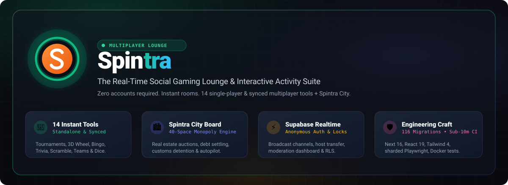
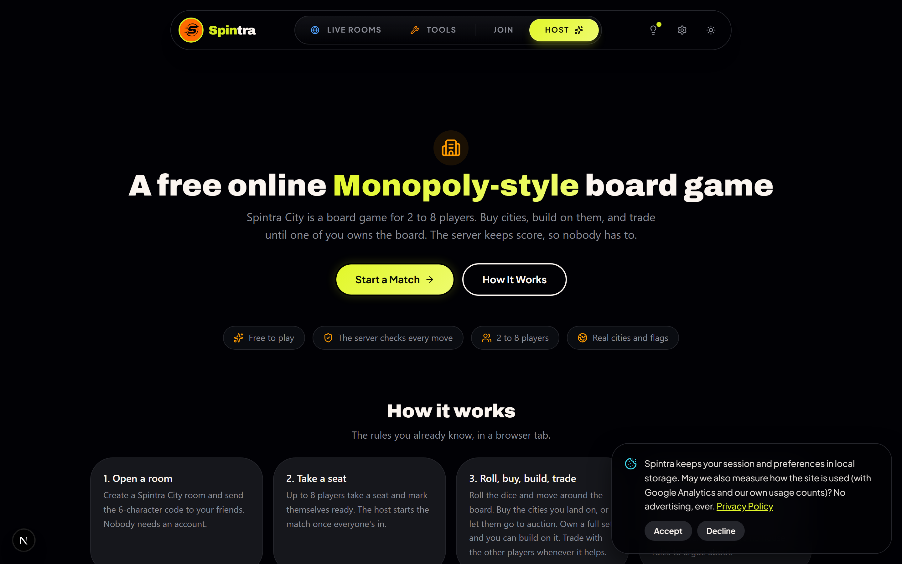
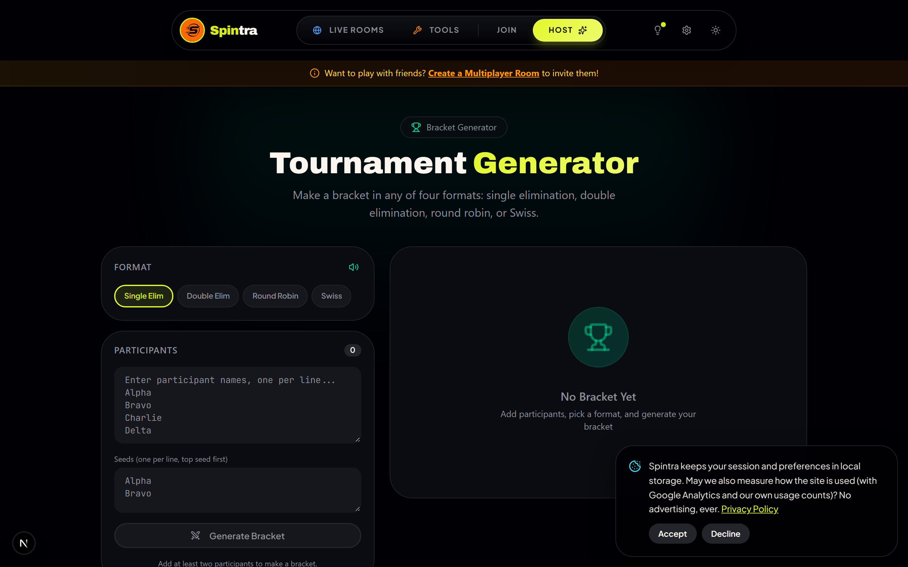
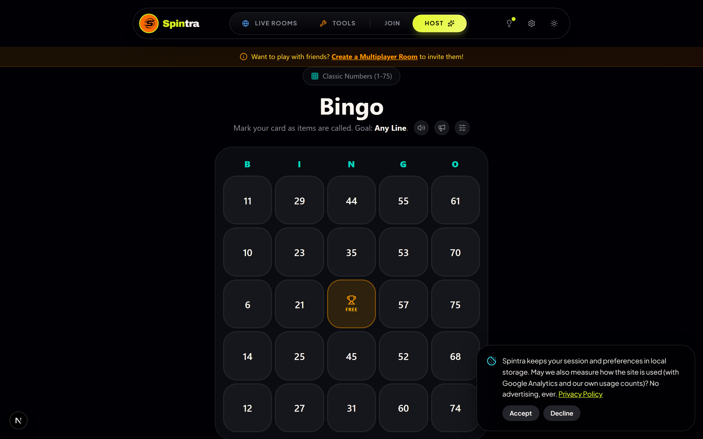
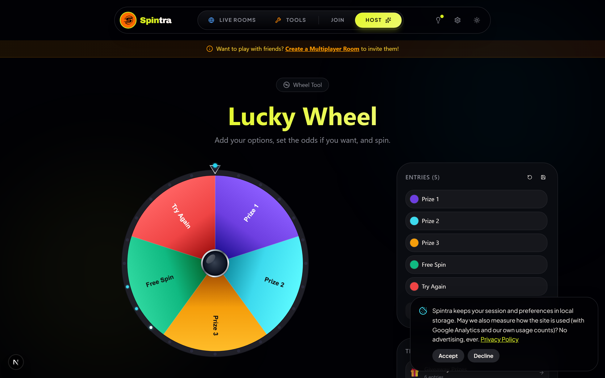
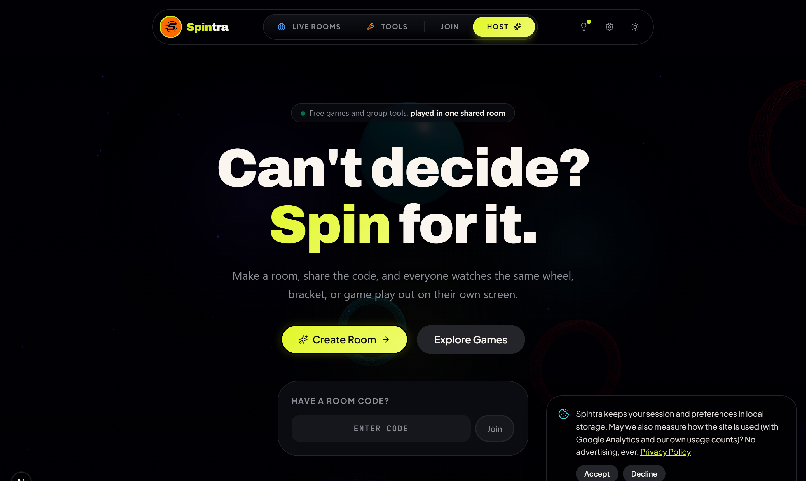
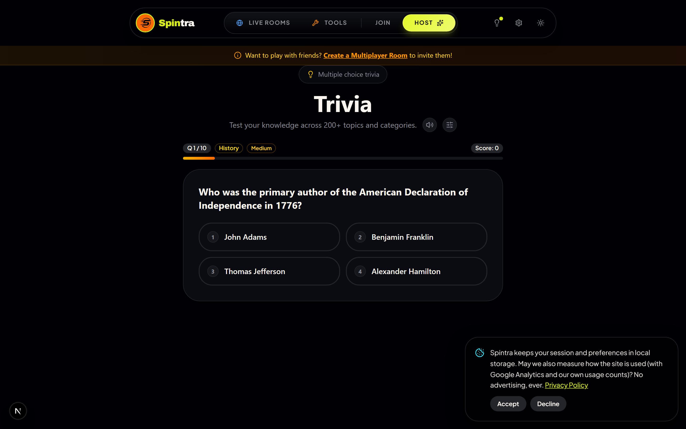
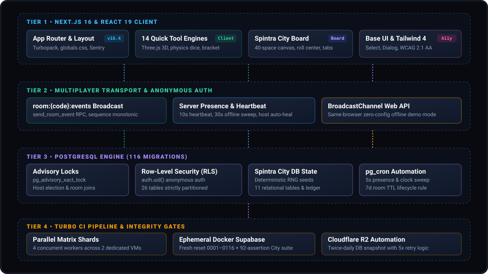

<div align="center">



<br/><br/>

[](https://spintra.io)
[](https://nextjs.org)
[](https://react.dev)
[](https://supabase.com)
[](https://tailwindcss.com)
[](supabase/migrations)
[](https://github.com/TejuBoricha/Spintra/actions/workflows/ci.yml)
[](tests/ux-axe.spec.ts)

<br/>

**The real-time social gaming lounge & interactive activity suite for classrooms, friend groups, and game nights.**  
*Zero account walls. Instant room codes. 14 standalone quick tools plus Spintra City.*

[Explore Live on spintra.io](https://spintra.io) • [Spintra City](#-the-crown-jewel-spintra-city) • [14 Quick Tools](#-14-instant-game-tools) • [Architecture](#-system-architecture) • [Quickstart](#-quickstart) • [Documentation](docs/INDEX.md)

</div>

<br/>


## 🌟 The Spintra Experience

Spintra redefines browser gaming by stripping away friction. No sign-ups, no email verification, and no app store installs. Whether you're an educator running a classroom trivia review, a team lead organizing icebreaker dares, or friends rolling dice in a 40-space board game match, Spintra delivers instant real-time synchronization directly in your browser.

<br/>

<table>
  <tr>
    <td width="50%" valign="top">
      <h3 align="center">🏙️ Spintra City Board Engine</h3>
      <p>A full-fledged, real-time multiplayer board game. Acquire properties, initiate dynamic auctions, mortgage assets, resolve customs detentions, and settle debt with full deterministic state enforcement.</p>
    </td>
    <td width="50%" valign="top">
      <h3 align="center">🎲 14 Instant Game Tools</h3>
      <p>A comprehensive library of single-player utilities and synced room activities: 3D physics dice, interactive tournament bracket generators, themed bingo cards, trivia arenas, and lucky prize wheels.</p>
    </td>
  </tr>
  <tr>
    <td width="50%" valign="top">
      <h3 align="center">🏫 Classroom &amp; Party Hub</h3>
      <p>Dedicated room configurations for teachers and party hosts. Includes teacher-exclusive chat controls, participant moderation dashboards, instant team balancing, and auto-healing host migrations.</p>
    </td>
    <td width="50%" valign="top">
      <h3 align="center">🛡️ Enterprise-Grade Hardening</h3>
      <p>116 PostgreSQL migrations with transaction-scoped advisory locks (<code>pg_advisory_xact_lock</code>), row-level security on all 26 tables, sequence-monotonic event catch-up, and an offline Web API fallback.</p>
    </td>
  </tr>
</table>

<br/>


## 📸 Visual Showcase

<div align="center">
  <p><em>Experience Spintra's aesthetic: dark-mode glassmorphism, responsive container queries, and fluid animations.</em></p>
</div>

### 1. Spintra City &amp; Tournament Arena

<table>
  <tr>
    <td width="50%" align="center">
      <b>Spintra City: 40-Space Interactive Monopoly Board</b>
      <br/><br/>
      
      <br/>
      <sub>Dynamic auctions, property mortgages, customs corner, and responsive laptop/phone layouts.</sub>
    </td>
    <td width="50%" align="center">
      <b>Tournament Engine: Single, Double &amp; Swiss Brackets</b>
      <br/><br/>
      
      <br/>
      <sub>Interactive seeding, auto bye resolution, match score dialogs, and tiebreak calculations.</sub>
    </td>
  </tr>
</table>

### 2. Live Gaming Lounge &amp; Atmosphere

<table>
  <tr>
    <td width="50%" align="center">
      <b>Bingo Activity: Base UI Themed Select &amp; Call Matrix</b>
      <br/><br/>
      
      <br/>
      <sub>Responsive card grid, dynamic party/science themes, daub markers, and verified win claims.</sub>
    </td>
    <td width="50%" align="center">
      <b>Lucky Wheel: Three.js 3D Physics Canvas</b>
      <br/><br/>
      
      <br/>
      <sub>Real-time canvas rendering, customizable slice probabilities, and haptic deceleration.</sub>
    </td>
  </tr>
  <tr>
    <td width="50%" align="center">
      <b>Homepage Hero &amp; Aurora Atmosphere</b>
      <br/><br/>
      
      <br/>
      <sub>Floating glass pill navbar, instant room code joiner, and endless living footer table.</sub>
    </td>
    <td width="50%" align="center">
      <b>Trivia Arena &amp; Multiplayer Scramble</b>
      <br/><br/>
      
      <br/>
      <sub>Category filters, server-verified score awards, streak multipliers, and instant XP leveling.</sub>
    </td>
  </tr>
</table>

<br/>


## 🏙️ The Crown Jewel: Spintra City

**Spintra City** is a complete, relational board game engine built natively on top of PostgreSQL and Supabase Realtime:

* **The Wheelworks Board**: 40 distinct spaces featuring 22 purchasable properties across 8 color sets, 4 transit stations, 2 utility companies, Customs detention, and event card spaces.
* **Deterministic Randomness**: Dice outcomes and card draws are derived deterministically from `(rng_seed, rng_counter)` on the server. Seeds cannot be spoofed, manipulated, or read ahead of time by clients.
* **Liquid Reserve Auctions**: When a player declines a landed property, an automated auction opens with an opening reserve price equal to mortgage value. Bids extend the auction timer dynamically.
* **Automated Debt &amp; Bankruptcy**: Players in debt can mortgage properties and sell buildings. If funds cannot be raised before the timer expires, the server's autopilot liquidates assets and transfers holdings to the creditor.
* **Server-Owned Timekeeper (`city_tick`)**: Clocks are held authoritatively by the database via `pg_cron` every 5 seconds. If a player disconnects mid-turn, autopilot steps in seamlessly without stalling the room.

<br/>


## 🎯 14 Instant Game Tools

Every tool runs as a standalone single-player utility at `/tools/<name>` and seamlessly converts into a synced multiplayer room activity at `/room/[code]`:

| Tool | Route | Capability &amp; Highlights |
|---|---|---|
| **Spintra City** | `/spintra-city` | 40-space multiplayer board game with auctions, debt settlement, and autopilot |
| **Tournament** | `/tools/tournament` | Single elimination, double elimination, Swiss, and round-robin bracket engine |
| **Lucky Wheel** | `/tools/lucky-wheel` | 3D physics-driven prize wheel with slice customization and template libraries |
| **Bingo** | `/tools/bingo` | Base UI themed bingo with custom word/number pools, call matrices, and win verification |
| **Trivia** | `/tools/trivia` | Timed multiple-choice question arena with streak bonuses and XP leveling |
| **Team Maker** | `/tools/team-maker` | Random and skill-balanced team generator with drag-and-drop roster management |
| **Name Draw** | `/tools/name-draw` | Random name picker with multiset exclusion, redraw history, and elimination mode |
| **Dice Roller** | `/tools/dice` | 3D physics dice simulator supporting D4, D6, D8, D10, D12, D20, and custom sets |
| **Coin Flip** | `/tools/coin-flip` | Physics-based coin flipper with heads/tails streak tracking |
| **Guess Number** | `/tools/guess-number` | Binary search number game with server-side secret validation and hint throttling |
| **Word Scramble** | `/tools/word-scramble` | Live multiplayer anagram scramble race with hint reveals |
| **Rock Paper Scissors** | `/tools/rps` | Synchronized duel arena with hidden selection and simultaneous reveals |
| **Truth or Dare** | `/tools/truth-or-dare` | Classroom and party-safe prompt decks with randomizer cards |
| **Would You Rather** | `/tools/would-you-rather` | Percentage-revealing polling activity with crowd sentiment tracking |
| **Never Have I Ever** | `/tools/never-have-i-ever` | Filtered party icebreakers with live confessions and voting |

<br/>


## 🏗️ System Architecture

Spintra operates as a client-orchestrated, database-verified system. Business logic is backed by transactional stored procedures, row-level security policies, and advisory locks.

<div align="center">
  
</div>

### Architectural Highlights

1. **Anonymous Authentication Model**:
   - Every participant receives an authenticated `auth.users` identity without providing credentials or email addresses.
   - All 26 database tables enforce Row-Level Security (RLS) policies scoped strictly to `auth.uid()`.
2. **Transaction-Scoped Advisory Locks (`pg_advisory_xact_lock`)**:
   - Host elections (`elect_room_host`), room joins, and trivia scoring operations acquire transaction-scoped locks on room hash IDs, completely serializing race conditions without table locks.
3. **Monotonic Event Log &amp; Replay**:
   - Game events pass through the `send_room_event` RPC, which validates game rules, stamps sequential event numbers (`seq`), verifies room membership, and broadcasts over Supabase Realtime.
   - Disconnected clients automatically detect sequence gaps and sync state from `room_activity_state`.
4. **Zero-Config Offline Fallback**:
   - When launched without Supabase credentials, the client falls back to the native browser `BroadcastChannel` API. Single-player tools and same-browser multiplayer rooms function out of the box with zero external dependencies.

<br/>


## 🚀 Quickstart

### 1. Zero-Config Local Run (Offline Mode)

You can run Spintra locally without configuring any external services or database:

```bash
# Clone the repository
git clone https://github.com/TejuBoricha/Spintra.git
cd Spintra

# Install dependencies
npm ci

# Start Next.js with Turbopack
npm run dev
```

Open [http://localhost:3000](http://localhost:3000) (or `http://127.0.0.1:3200`). Single-player tools and local multiplayer testing via `BroadcastChannel` are immediately active!

### 2. Full Multiplayer with Supabase

To run true multi-device multiplayer:

1. Create a free project at [supabase.com](https://supabase.com).
2. Copy `.env.example` to `.env.local` and fill in your keys:
   ```env
   NEXT_PUBLIC_SUPABASE_URL=https://your-project.supabase.co
   NEXT_PUBLIC_SUPABASE_ANON_KEY=your-anon-public-key
   ```
3. Push all migrations:
   ```bash
   npx supabase db push
   ```

### 3. Ephemeral Local Docker Stack (Recommended for Contributors)

```bash
# Start local Supabase Docker instance
npx supabase@2.109.0 start -x studio,logflare,vector,mailpit,imgproxy,postgres-meta,edge-runtime

# Reset and apply all 116 migrations fresh from scratch
npx supabase@2.109.0 db reset
```

<br/>


## 📜 Complete Scripts Inventory

All 14 npm scripts defined in `package.json` are maintained and verified:

| Command | Category | Description |
|---|---|---|
| `npm run dev` | Development | Starts Next.js development server with Turbopack (defaults to `http://localhost:3000`). |
| `npm run build` | Build | Compiles production application with route optimization and asset hashing. |
| `npm run start` | Production | Starts production server against compiled `.next` artifacts. |
| `npm run lint` | Code Quality | Executes ESLint analysis with custom rules for accessibility and design consistency. |
| `npm run typecheck` | Code Quality | Runs `tsc --noEmit` to validate all TypeScript types and schemas without generating files. |
| `npm run docs:check` | Architecture | Runs `scripts/check-docs-drift.mjs` to ensure documentation matches code, schemas, and migrations. |
| `npm run verify:static` | Quality Gate | Bundled static gate: executes `typecheck`, `lint`, and `docs:check` in one fast offline pass. |
| `npm run verify` | Quality Gate | Primary developer gate: executes `verify:static` plus the `npm run audit` security check. |
| `npm run verify:migration` | Database | Verifies that a migration's objects exist live in the linked Supabase project. |
| `npm run test:smoke` | Testing | Runs full Playwright end-to-end smoke test suite across all desktop and mobile viewports. |
| `npm run test:related` | Testing | Intelligently executes only the Playwright tests that cover modified files. |
| `npm run test:city-regression` | Testing | Executes the 92-assertion Spintra City database regression suite against Supabase. |
| `npm run audit` | Security | Runs `scripts/audit-gate.mjs` against moderate-threshold advisories with dated allowlist exceptions. |
| `npm run ci` | Full CI Gate | Executes local equivalent of CI: `verify` + `build` + `test:smoke`. |

<br/>


## ⚡ Turbo CI Pipeline &amp; Quality Gates

Spintra employs a sub-10 minute CI pipeline on GitHub Actions (`.github/workflows/ci.yml`):

* **Parallel Matrix Sharding**: The `validate-shard` job splits test execution across two concurrent runner VMs (`1/2` and `2/2`), each running 2 parallel Playwright workers (total of **4 concurrent test workers**).
* **Aggregating Gateway**: A lightweight 5-second `validate` gateway job aggregates shard statuses to strictly satisfy GitHub repository branch protection rules (`strict: true`).
* **Ephemeral Database Integration**: The `db-integration` job spins up an isolated Supabase Docker stack, runs all 116 migrations fresh from scratch, and executes real multiplayer tests against PostgreSQL RLS and trigger policies.

<br/>


## 🛡️ Security, Privacy &amp; Governance

- **Zero PII Collection**: Spintra does not collect user emails, passwords, phone numbers, or persistent advertising cookies.
- **Automated Backup Automation**: `.github/workflows/db-backup.yml` snapshots production database state twice daily (03:00 and 15:00 UTC) with exponential retries and uploads encrypted backups to Cloudflare R2 with zero egress fees.
- **Reporting Vulnerabilities**: Review [SECURITY.md](SECURITY.md) for our private vulnerability disclosure process.

<br/>


## 📄 License &amp; Portfolio Reference

All rights reserved. This repository is source-available for portfolio, review, and educational reference purposes. Reuse, redistribution, or modification of this codebase without the author's prior permission is prohibited.

<div align="center">
  <br/>
  <sub>Crafted with passion, precision, and engineering excellence by <b>Tejas Gogara</b>.</sub>
  <br/>
  <sub>Spintra • Free browser games and multiplayer tools for everyone.</sub>
</div>
